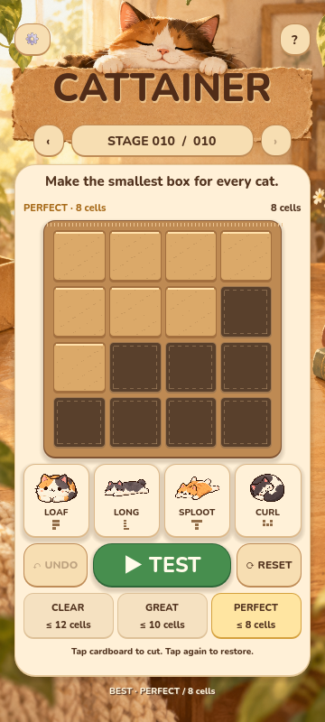

# CATTAINER

A cozy cardboard puzzle for **Godot 4.7 / Windows**. Cut a connected 4×4 box down until every required cat can fit into it **one at a time**. Cats rotate in quarter turns; they never reflect.

**Stage 001–010 are playable**, with verified PERFECT targets, independent fit animations, Undo / Reset, local progression, generated cat illustrations, commercial-use music and CC0 sound effects.



## Play on Windows

Run `build/windows/CATTAINER.exe` from the local workspace. It embeds its game data and needs no Godot installation or network connection. `build/windows/CATTAINER-v0.1-Windows.zip` is the local portable package. Builds are ignored by Git.

To run from source, open `project.godot` in **Godot 4.7** and press **F6** on `scenes/main.tscn`, or **F5** for the whole project. Alternatively:

```powershell
godot --path .
```

## How to play

1. Click / tap cardboard to remove it; tap a recessed cell to restore it.
2. Keep the remaining cells connected horizontally or vertically. Cuts that split the box, or remove the last cell, are rejected.
3. Press **TEST**. Each cat independently tries the same box, with rotations allowed.
4. All cats must fit, and the cell count must meet the CLEAR threshold to unlock the next stage. A 16-cell box reports FIT and asks you to trim it.
5. Reach GREAT or PERFECT with fewer cells. Multiple perfect shapes are valid.

Restoration is always allowed, including an isolated piece; TEST requires reconnecting it. This follows the specification's explicit restoration rule while enforcing connectivity at completion.

Keyboard: **Space** TEST, **Ctrl+Z** Undo, **R** Reset, **Esc** close a dialog. The stage label opens the stage picker. The gear opens music / effects / reduced-motion settings. Help includes Japanese instructions.

Saves use Godot's `user://save.cfg`, normally `%APPDATA%/Godot/app_userdata/CATTAINER/save.cfg` on Windows. QA uses separate named save files.

## Verify

Python is **development-only**, used exclusively for the independent exhaustive verifier.

```powershell
python tools/verify_stages.py --write
godot --headless --editor --import --quit
godot --headless --debug --ignore-error-breaks --script tests/check_project.gd
godot --headless --debug --ignore-error-breaks --script tests/run_tests.gd
```

Or use `tools/check.ps1 -GodotPath C:/path/to/godot.exe`. The gameplay suite exercises all ten stages through accepted cell edits, asynchronous TEST, ranking and progression. Tests never overwrite the player's save.

`data/verification.json` records exhaustive minima, the number of optimal board masks, and one witness per stage. It is evidence for tests, not a runtime solver dependency.

## Build

Install Godot's matching **4.7.stable Windows export templates**, then:

```powershell
New-Item -ItemType Directory -Force build/windows
godot --headless --export-release "Windows Desktop" build/windows/CATTAINER.exe
```

The preset embeds the pack, exports GDScript as binary tokens and excludes tools, tests and documentation. No code-signing setup is required for local testing; the prototype executable is unsigned.

## Implementation

- `FitSolver`: pure deterministic search in rotation order 0/90/180/270, then y/x order; no reflection generation.
- `BoardModel`: 16-bit state, 4-connected flood fill, history and reset.
- `StageLoader` / `ProgressStore`: JSON data, rank thresholds and local ConfigFile persistence.
- `CattainerGame`: input / sequence controller; `BoardView`, `BoardCell`, `CatCard`, `ResultOverlay`, `UIFeedback` handle presentation.
- Motion: 130 ms cardboard cut / pop, 210 ms rejection shake, 270 ms cat entry, 280 ms result overshoot and paper sparkle bursts. Reduced motion is saved locally.

Asset sources and commercial-use conditions are in [assets/ATTRIBUTION.md](assets/ATTRIBUTION.md). BGM: **昼下がり気分 / KK**, downloaded from OpenTracks and converted into a compressed Godot resource. Original music is not an independently redistributable asset. Cat art and the room background were generated with **Imagegen**.

See [validation results](docs/VALIDATION_v0.1.md) for test evidence and human playtest items.
